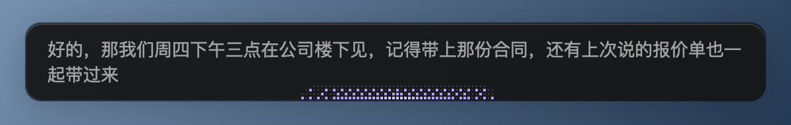
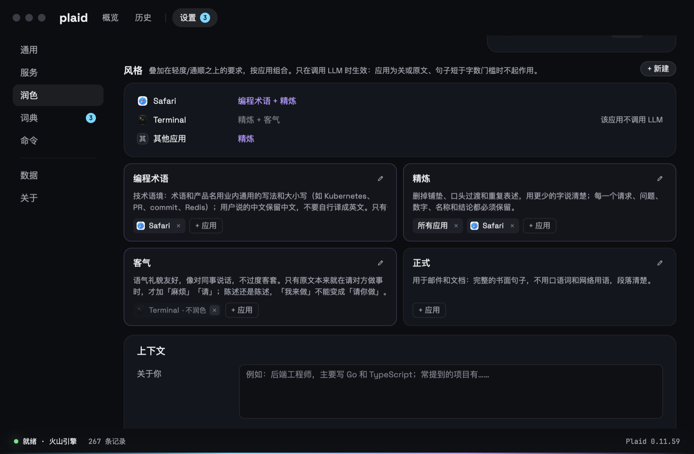
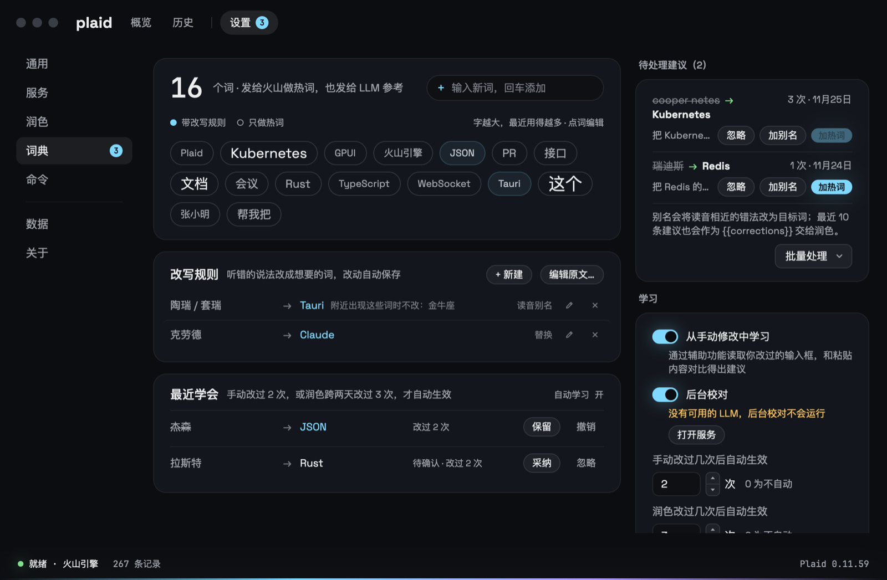
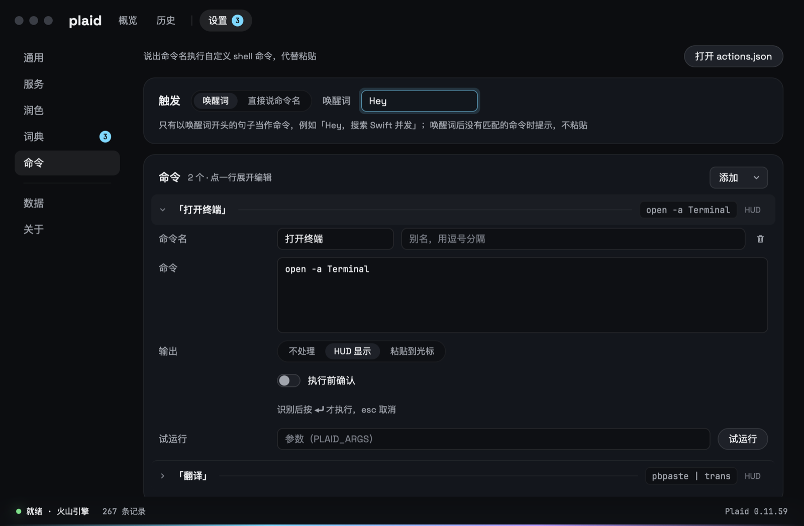
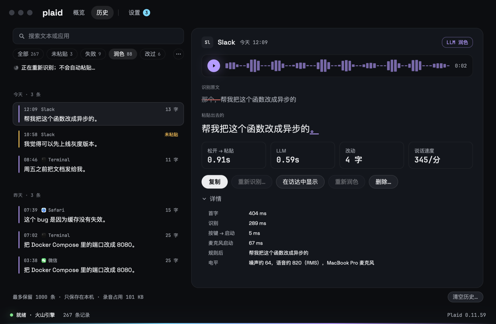
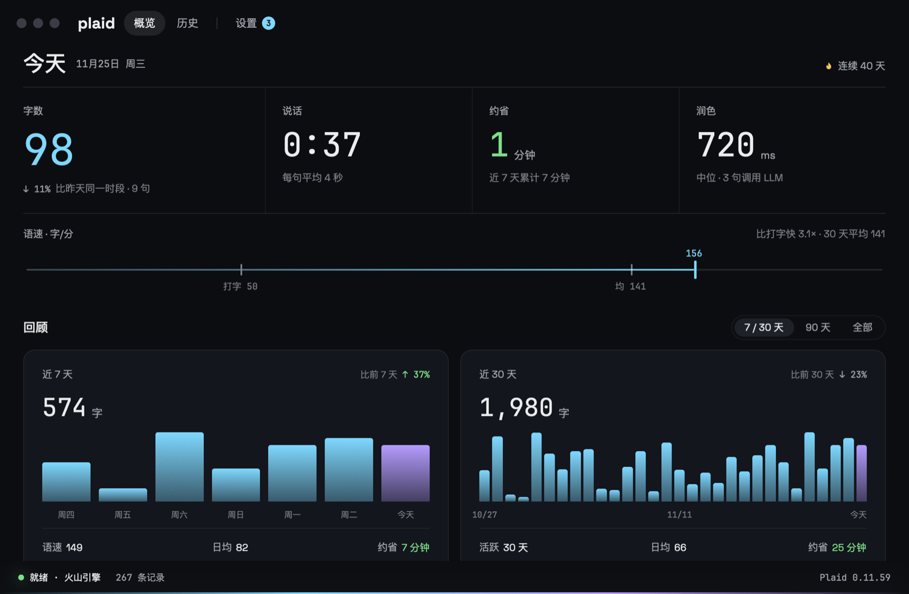
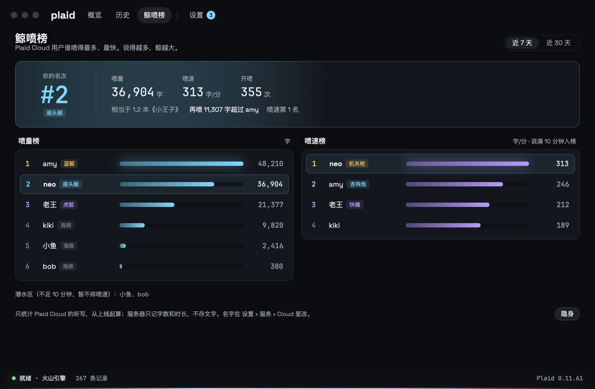

# Plaid

English | [简体中文](README.zh-CN.md)

Voice dictation for macOS and Windows. Hold a key, speak, release: the text is pasted into whatever input field has
focus. Recognition uses Volcengine's Doubao streaming ASR (bigmodel), either with your own API key or through Plaid
Cloud (invite-only, no key needed). An optional LLM pass removes fillers and fixes typos and punctuation before
pasting. The UI is in Simplified Chinese; screenshots below use sample data.


## What it's for

### Replying in chat, writing an email

Put the cursor in Slack, WeChat, Mail or a terminal, hold right ⌥ and talk. The words appear in a strip at the
bottom of the screen as you speak, so you can see whether it heard you. Release the key and the text is pasted.
For longer passages, tap the key once to go hands-free and tap again (or press ⏎) when done; esc cancels.

### Speech in, written text out

Spoken sentences carry fillers like 那个 / 就是 and loose punctuation. With polishing on, an LLM cleans that up
before pasting, while the strip shows it working. Levels are 关 / 轻度 / 通顺. Short sentences (under 20 characters or
words by default) skip the LLM
so they paste immediately.



On top of a level you can stack styles per app, such as 编程术语 (keep product names in their usual casing, don't
translate Chinese into English) for the browser, or 正式 for email. Styles are plain-language instructions you can
edit.



### Names and jargon

ASR gets names and technical terms wrong: Kubernetes, Tauri, a colleague's name. Add them to 词典 and they are sent
to Volcengine as hotwords and to the LLM as reference. Rewrite rules map what was heard to what you meant
(克劳德 → Claude). When you fix a pasted sentence by hand, Plaid notices the edit and suggests a rule; after the
same fix a couple of times it applies the rule on its own and lists it under 最近学会, where you can keep or undo it.



### Voice commands

Map a spoken phrase to a shell command in 命令: "Hey, 打开终端" runs `open -a Terminal`. The rest of the sentence is
passed as `$PLAID_ARGS`, the whole sentence as `$PLAID_TEXT`. Output can be ignored, shown in the strip, or pasted
at the cursor. Commands can ask for confirmation first (⏎ to run, esc to cancel).




### Going back to an earlier dictation

历史 keeps recent dictations with the app they went to, the raw recognition next to what was pasted, the recording,
and timings. If a paste didn't land, copy it from here. If the network dropped, re-recognize the recording. You can
re-polish, select a word to add it to 词典, or delete entries.



### How much you use it

概览 shows today's characters, speaking time, time saved compared with typing, LLM latency and your speaking speed,
plus 7, 30 and 90-day views.



### Comparing with friends

With Plaid Cloud, a 鲸喷榜 tab ranks Cloud users over the last 7 or 30 days: by characters dictated, and by
characters per minute of speech once someone has spoken for 10 (or 30) minutes. It shows your rank, the gap to the
next place and how many books your total adds up to. You can leave the board at any time (隐身) and change your
name (up to 8 characters) in 设置 › 服务 › Cloud.



## Requirements

- macOS 13+ (Apple silicon or Intel), or Windows 11 x64.
- One of:
  - **BYOK**: a Volcengine API key with Doubao streaming speech recognition (bigmodel) enabled, plus optionally any
    OpenAI-compatible or Anthropic-compatible LLM endpoint for polishing.
  - **Plaid Cloud**: an invite code. Recognition, polishing and learning run on the Cloud server; usage is paid
    from a credit balance the admin tops up.

## Install

Download the zip for your platform from [Releases](https://github.com/plaidhq/plaid/releases) (`macos-arm64` for Apple silicon, `macos-x64` for Intel Macs). The builds are not notarized (macOS) or code-signed for SmartScreen (Windows).

- **macOS**: unzip, move `Plaid.app` to Applications and open it once. When macOS blocks it, go to System Settings ›
  Privacy & Security and choose Open Anyway. Grant Microphone and Accessibility when asked; Accessibility is used
  for the global hotkey and for pasting. Releases are signed with the same self-signed certificate, so the grants
  carry over to updates.
- **Windows**: unzip and run `plaid.exe`. On the SmartScreen prompt choose More info › Run anyway.

Plaid checks GitHub for new releases every 6 hours and can update itself (设置 › 关于).

## Setup

Open 设置 › 服务 and pick a tab:

- **Cloud**: enter the invite code and choose 登录. The page then shows your account, credit balance and this
  month's usage. Codes are single-use and expire after 7 days; the device keeps a token in the OS credential store.
- **BYOK**: paste the Volcengine API key. Optionally, under LLM pick a preset or enter an endpoint, model and key,
  then run 测试. Keys are stored locally (Keychain on macOS, Credential Manager on Windows).

Then turn polishing on in 设置 › 润色 and choose a level (关 / 轻度 / 通顺). Levels, styles and the dictionary
work the same in both modes.

## Use

- **Hold right ⌥ (right Alt on Windows)** to dictate; release to paste.
- **Tap it** for hands-free dictation; tap again or press ⏎ to finish, esc to cancel.
- Both keys can be changed or disabled in 设置 › 通用.

## Data

- BYOK: audio goes to Volcengine. With 发送上下文 on, a short piece of text before the cursor and the app name go
  too. With polishing or background checking on, the recognized text, app name and window title go to the LLM
  endpoint you configured.
- Plaid Cloud: the same data goes to the Cloud server, which passes it to Volcengine and its LLM provider. The
  server stores no audio and no text, and its logs carry only ids, sizes and timings. It records per dictation the
  audio length, character count, token counts and cost, which feed the balance and 鲸喷榜.
- History, recordings and edit records stay on this machine. Keeping recordings can be turned off in 设置 › 数据, and
  entries can be deleted in 历史.

## Build

The app is Rust, using [GPUI](https://www.gpui.rs) through `gpui-kit`. It lives in `app/`: `core` (pipeline,
no UI), `plaid` (the app) and `cloud` (the Plaid Cloud server, see [docs/cloud.md](docs/cloud.md)).

```sh
cd app
cargo run -p plaid              # dev build; on macOS its default hotkey is right ⌘
cargo test --workspace
./bundle.sh release             # macOS: target/Plaid.app
```

Headless helpers:

- `plaid --file a.wav` replays a recording through the pipeline.
- `plaid --recover [at]` re-recognizes a saved recording.
- `plaid --learn-report` prints what the learner has collected.
- `plaid --update` updates from the command line.

CI builds and tests on Windows and Intel macOS on every push to `main`. A `v*` tag builds macOS (arm64, x64) and
Windows and publishes a release.

## License

[Apache-2.0](LICENSE).
