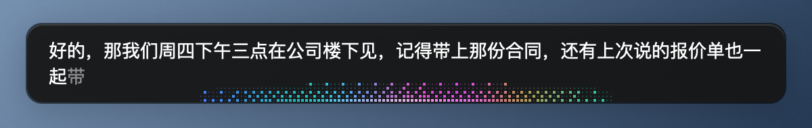
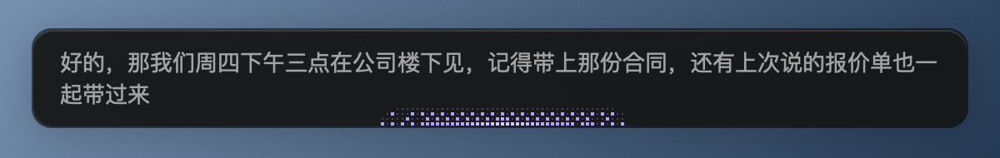
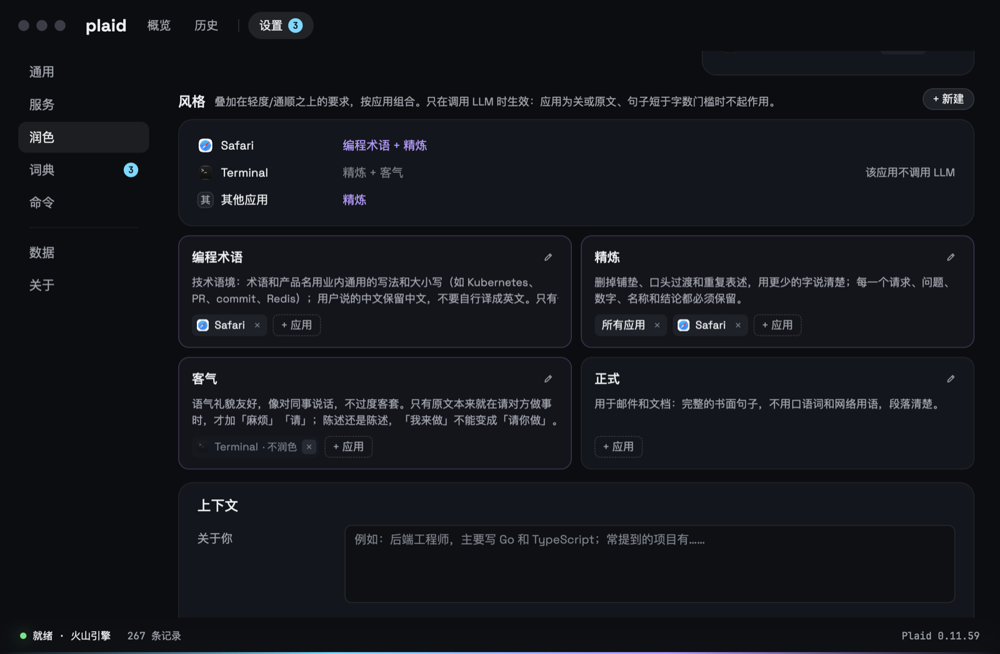
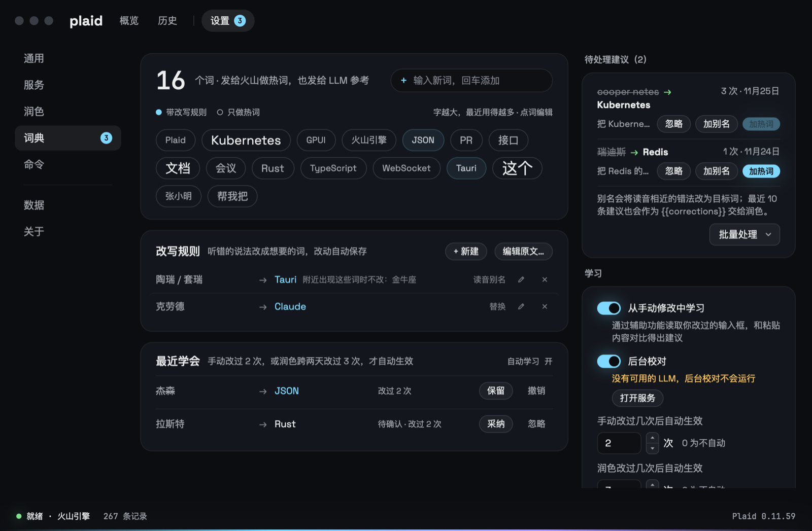
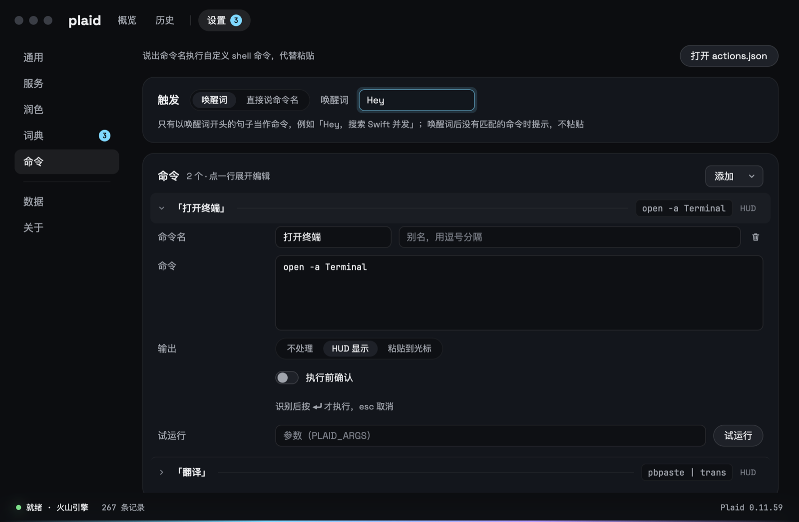
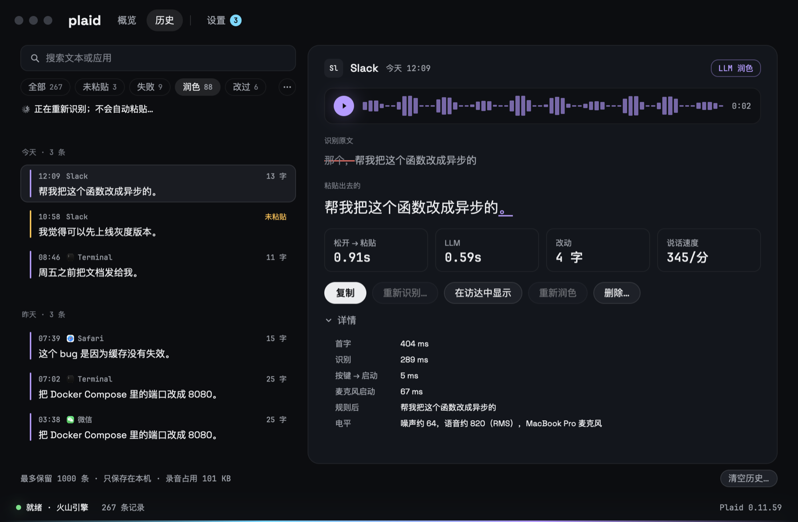
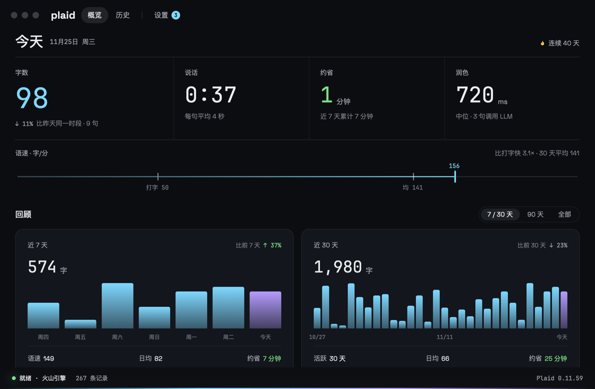
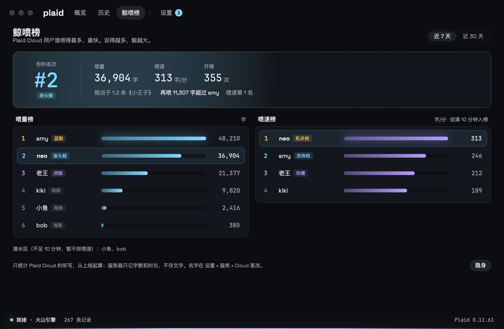

# Plaid

[English](README.md) | 简体中文

macOS 和 Windows 上的语音输入。按住一个键说话，松开后文字粘贴到当前焦点所在的输入框。识别用火山引擎豆包流式语音识别
（大模型版），可以自带 API key，也可以用 Plaid Cloud（邀请制，不需要 key）；可选再过一遍 LLM，去掉口头语、修正错字和标点后再粘贴。界面为简体中文，下面的截图都是示例数据。



## 用在哪里

### 回消息、写邮件

光标放在 Slack、微信、邮件或终端里，按住右 ⌥ 说话。说的内容会实时出现在屏幕底部的条里，能看出它有没有听对。松开按键，
文字就粘贴进去。说长段落时，轻点一下进入免按住模式，说完再点一下（或按 ⏎）结束，esc 取消。

### 口语进，书面语出

说出来的话常带「那个」「就是」这类口头语，标点也随意。打开润色后，LLM 会在粘贴前把这些整理掉，底部条显示处理中。
润色分 关 / 轻度 / 通顺 三档。短句（默认不到 20 字，英文按词计）跳过 LLM，直接粘贴。



在档位之上还可以按应用叠加风格，比如浏览器用「编程术语」（术语和产品名用通行写法和大小写，中文不擅自翻成英文），
邮件用「正式」。风格就是一段可编辑的文字要求。



### 人名和术语

语音识别容易把人名和技术词听错：Kubernetes、Tauri、同事的名字。把它们加进词典，会作为热词发给火山引擎，也发给 LLM
参考。改写规则把听到的说法改成想要的词（克劳德 → Claude）。粘贴后你手动改了某个词，Plaid 会记下这次修改并提出规则建议；
同样的修改出现几次后自动生效，列在「最近学会」里，可以保留或撤销。



### 语音命令

在「命令」里把一句话对应到一条 shell 命令：说「Hey，打开终端」就执行 `open -a Terminal`。命令名之后的内容放在
`$PLAID_ARGS`，整句话在 `$PLAID_TEXT`。输出可以不处理、显示在底部条里，或粘贴到光标处。命令可以设成执行前确认
（⏎ 执行，esc 取消）。




### 回头找之前说过的话

「历史」保存最近的输入记录：发到了哪个应用、识别原文和实际粘贴的文字对照、录音和各段耗时。粘贴没成功时可以从这里复制；
网络断了可以用录音重新识别。也可以重新润色、选中文字加入词典，或删除记录。



### 用了多少

「概览」显示今天的字数、说话时长、比打字约省的时间、LLM 耗时和语速，以及近 7 / 30 / 90 天的统计。



### 和朋友比一比

用 Plaid Cloud 时会多一个「鲸喷榜」，按近 7 天或 30 天给 Cloud 用户排名：一个比说了多少字，一个比每分钟说多少字
（累计说满 10 分钟，30 天榜是 30 分钟，才进榜）。页面显示你的名次、离上一名还差多少字、总字数相当于几本书。随时可以
「隐身」退出榜单，名字（最多 8 个字符）在 设置 › 服务 › Cloud 里改。



## 系统要求

- macOS 13 及以上（Apple 芯片或 Intel），或 Windows 10 1809 及以上 / Windows 11（x64）。
- 二选一：
  - **BYOK（自带 key）**：开通了豆包流式语音识别（大模型版）的火山引擎 API key；润色可选任意 OpenAI 兼容或
    Anthropic 兼容的 LLM 接口。
  - **Plaid Cloud**：一个邀请码。识别、润色和学习都由 Cloud 服务器完成，用量从管理员充值的 credit 余额里扣。

## 安装

从 [Releases](https://github.com/plaidhq/plaid/releases) 下载对应平台的 zip（Apple 芯片用 `macos-arm64`，Intel Mac 用
`macos-x64`）。macOS 版没有公证，Windows 版没有 SmartScreen 认可的签名。

- **macOS**：解压，把 `Plaid.app` 移到「应用程序」并打开一次。被系统拦下时，到 系统设置 › 隐私与安全性 选「仍要打开」。
  按提示授予麦克风和辅助功能权限；辅助功能用于全局快捷键和粘贴。每个版本都用同一个自签名证书签名，更新后权限保留。
- **Windows**：解压后运行 `plaid.exe`。SmartScreen 提示时选 更多信息 › 仍要运行。

Plaid 每 6 小时检查一次 GitHub 上的新版本，可以自行更新（设置 › 关于）。

## 设置

打开 设置 › 服务，选一个标签：

- **Cloud**：输入邀请码，点「登录」。之后页面显示账户、credit 余额和本月用量。邀请码只能用一次，7 天内有效；
  登录后设备在系统凭据存储里保存一个 token。
- **BYOK**：粘贴火山引擎 API key。可选：在 LLM 部分选一个预设，或填入接口地址、模型和 key，然后点「测试」。
  key 保存在本机（macOS 钥匙串，Windows 凭据管理器）。

然后在 设置 › 润色 打开润色并选档位（关 / 轻度 / 通顺）。档位、风格和词典在两种模式下一样生效。

## 使用

- **按住右 ⌥（Windows 上是右 Alt）** 说话，松开粘贴。
- **轻点一下** 进入免按住模式；再点一下或按 ⏎ 结束，esc 取消。
- 两个按键都可以在 设置 › 通用 里更改或关闭。

## 数据

- BYOK：音频发送到火山引擎。打开「发送上下文」时，光标前的一小段文字和应用名也会一起发送。打开润色或后台校对时，
  识别文字、应用名和窗口标题会发送到你配置的 LLM 接口。
- Plaid Cloud：同样的数据发到 Cloud 服务器，由它转给火山引擎和它的 LLM 服务商。服务器不保存音频和文字，日志里只有
  id、大小和耗时。每次听写只记录音频时长、字数、token 数和费用，用于扣余额和鲸喷榜。
- 历史、录音和修改记录只保存在本机。可以在 设置 › 数据 关闭录音保存，在「历史」里删除记录。

## 构建

应用用 Rust 编写，通过 `gpui-kit` 使用 [GPUI](https://www.gpui.rs)，代码在 `app/`：`core`（识别与润色流程，
不含界面）、`plaid`（应用本体）和 `cloud`（Plaid Cloud 服务器，见 [docs/cloud.md](docs/cloud.md)）。

```sh
cd app
cargo run -p plaid              # dev build; on macOS its default hotkey is right ⌘
cargo test --workspace
./bundle.sh release             # macOS: target/Plaid.app
```

命令行工具：

- `plaid --file a.wav`：把一段录音走一遍完整流程。
- `plaid --recover [at]`：重新识别一条保存的录音。
- `plaid --learn-report`：打印学习模块收集到的内容。
- `plaid --update`：从命令行更新。

每次推送到 `main` 时 CI 会在 Windows 和 Intel macOS 上构建和测试；打 `v*` 标签会构建 macOS（arm64、x64）和
Windows 并发布 release。

## 许可

[Apache-2.0](LICENSE)。
